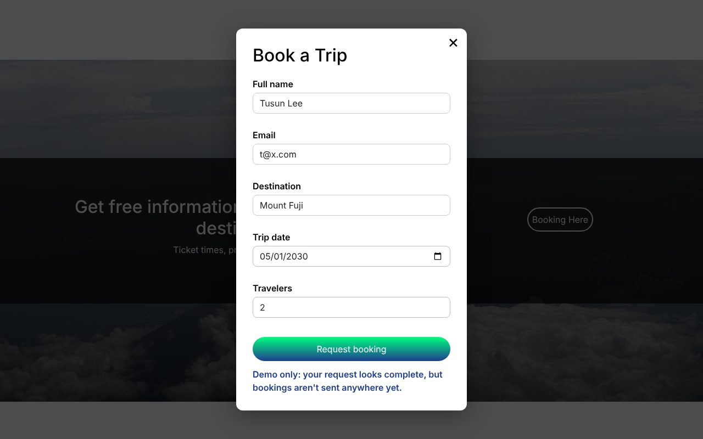

# Travel to Japan

A responsive travel website for planning a trip to Japan, built with HTML, CSS, Bootstrap 5 and vanilla JavaScript.

**Live site:** https://sub0sun.github.io/Travel-To-Japan/


## Features

- **Destination cards built from data.** `js/destinations.js` holds each destination (name, region, price, rating, description, address). `js/main.js` turns that list into cards, so adding a destination means adding one object instead of copying HTML.
- **Live search.** The search bar filters destinations by name, region, address or description as you type, and shows a message when nothing matches.
- **Photo lightbox.** Clicking a gallery photo opens it full size in a native `<dialog>`. Close it with the X, the Escape key, or a click outside the photo.
- **Login and booking forms with validation.** Each form checks its fields before submitting (email format, password length, a trip date that isn't in the past, 1–10 travelers) and shows an error under each field that needs fixing. There's no back end yet, so nothing is sent.
- **Responsive layout.** The Bootstrap grid stacks the cards and gallery on phones; custom CSS adds hover effects and transitions.



## Built with

- HTML5 and CSS3
- [Bootstrap 5.3](https://getbootstrap.com/) for the grid layout
- [Font Awesome 6](https://fontawesome.com/) for icons
- JavaScript (no frameworks)
- GitHub Pages for hosting

## Project structure

```
index.html             Page markup
TravelWeb.css          Custom styles
js/destinations.js     Destination data
js/main.js             Cards, search, lightbox and form logic
TravelImages/          Logo, backgrounds and reviewer photos
Japanimage/andy-photos Destination and gallery photos
docs/                  README screenshots
```

## Run it locally

Clone the repository and open `index.html` in a browser, or serve the folder with any static server, for example:

```
python3 -m http.server
```

## Credits

Destination and gallery photos (`Japanimage/andy-photos`) by Andy. Site by Tusun Lee.
